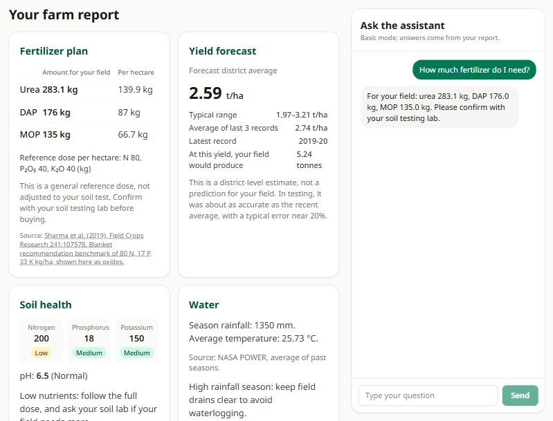
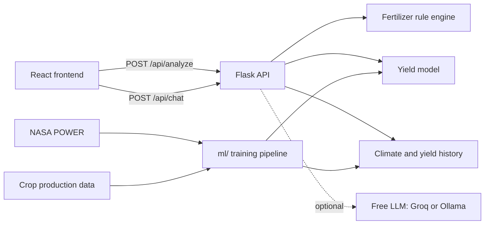

# 🌾 Fasal Sahaayak

**Crop advice for Odisha farmers, in English, Hindi and Odia.** Enter a soil test and farm details to get soil ratings, fertilizer quantities for your field, a district yield forecast, and a chat assistant that answers from your report.

Built for Smart India Hackathon 2025, then rebuilt around one rule: *never show a farmer a number that can't be justified.*



## Features

- **Fertilizer plan:** urea, DAP and MOP quantities scaled to your field, each with a linked source. Crops without a citable dose say so instead of guessing.
- **Soil ratings:** low, medium or high for N, P and K using ICAR bands, plus a pH class.
- **Yield forecast:** a district-level estimate for 10 crops, shown with a typical range and the recent average.
- **Water guidance:** season rainfall and temperature for all 30 districts, from NASA POWER data.
- **Chat assistant:** uses a free LLM when configured, and falls back to answers built from your report when it isn't, so it never needs payment.
- **Three languages:** the interface and offline chat answers are available in English, Hindi and Odia.

## What the evaluation found

Checking the original models changed the design of this project:

- **The fertilizer classifier scored 14%, the same as random guessing.** Its dataset's labels can't be learned from its features, so it was replaced with a transparent rule engine.
- **The yield model's reported R² of 0.95 was misleading.** Tested properly on future seasons with leaky features removed, it reaches R² 0.908 and ties a simple baseline (0.907), and it trails that baseline slightly when sugarcane is excluded. The app shows the baseline beside each forecast.
- **A weather bug gave the main monsoon rice crop 38 mm of rain instead of about 1,350 mm.** Season labels in crop statistics had been misread as calendar months.

The full reasoning and reproducible numbers are in [docs/MODEL_DECISIONS.md](docs/MODEL_DECISIONS.md).

## How it works



| Layer | Technology |
| --- | --- |
| Frontend | React 19, Vite, Tailwind CSS, Vitest, Testing Library |
| Backend | Python, Flask, Pydantic, Flask-Limiter, Gunicorn, pytest |
| Machine learning | scikit-learn (gradient boosting), pandas |
| Infrastructure | Docker Compose, GitHub Actions; configs for Vercel and Render |

## Run it locally

You need Python 3.11 and Node.js 20 or newer. Everything runs for free, with no API key.

**1. Start the API** at http://127.0.0.1:5000

```bash
cd backend
python -m venv .venv
.venv\Scripts\activate          # macOS/Linux: source .venv/bin/activate
pip install -r requirements.txt
python wsgi.py
```

**2. Start the frontend** at http://localhost:5173, in a second terminal

```bash
cd frontend
npm install
npm run dev
```

Or run both with Docker at http://localhost:8080:

```bash
docker compose up --build
```

## Enable free AI chat (optional)

Without this, chat answers offline from the farm report. Both options below cost nothing and need no card. Copy [backend/.env.example](backend/.env.example) to `backend/.env` and uncomment one option.

| Option | Setup |
| --- | --- |
| [Groq](https://console.groq.com/keys) free tier | Create a free key and set `LLM_API_KEY`. Requests are rate-limited, not billed, and chat falls back to offline answers at the limit. |
| [Ollama](https://ollama.com) on your machine | Install it, then set `LLM_API_KEY=ollama`, `LLM_BASE_URL=http://localhost:11434/v1` and `LLM_MODEL=llama3.2`. |

The API key stays on the server. Chat has per-visitor rate limits, and the assistant is instructed to use only the report for farm-specific figures.

## API

| Endpoint | Purpose |
| --- | --- |
| `GET /api/health` | Health check |
| `GET /api/options` | Accepted crops, seasons, districts and irrigation methods |
| `GET /api/model-metrics` | Evaluation results for the yield model |
| `POST /api/analyze` | Farm report |
| `POST /api/chat` | Assistant reply, limited to 10 per minute and 200 per day per visitor |

```bash
curl -X POST http://127.0.0.1:5000/api/analyze -H "Content-Type: application/json" -d "{\"crop\":\"rice\",\"district\":\"CUTTACK\",\"season\":\"winter\",\"field_acres\":5,\"nitrogen\":200,\"phosphorus\":18,\"potassium\":150}"
```

## Tests and retraining

```bash
cd backend
pip install -r requirements-dev.txt
pytest
ruff check .
```

```bash
cd frontend
npm test
npm run lint
```

To rebuild the model and its tables, run these from `backend/`:

```bash
python -m ml.fetch_nasa_weather
python -m ml.train_yield
python -m ml.audit_fertilizer_dataset
```

## Deployment

The project has configs for free hosting, but no public demo is running yet.

- **API:** [render.yaml](render.yaml) deploys to Render's free tier. Set `CORS_ORIGINS` to your frontend's URL. Free instances sleep when idle, so the first request can be slow.
- **Frontend:** deploy `frontend/` to Vercel and set `VITE_API_URL` to your API's URL.

## Project structure

```
backend/
  app/          Flask API: validation, fertilizer rules, forecasting, chat
  ml/           Data download, training and dataset audit scripts
  models/       Trained model and its evaluation metrics
  data/         Datasets, climate averages and yield history
  notebooks/    Original hackathon exploration
  tests/
frontend/
  src/          React components, API client and translations
docs/           Model decisions
```

## Limitations

This is guidance, not a substitute for local expertise. Doses come from published sources but haven't been reviewed by an agronomist, forecasts are district averages, yield data ends in 2019-20, and fertilizer doses currently cover rice and maize only. The Hindi and Odia text hasn't been reviewed by a native-speaking agricultural expert.

## Data sources

[NASA POWER](https://power.larc.nasa.gov/) for weather, and [India Agriculture Crop Production](https://www.kaggle.com/datasets/pyatakov/india-agriculture-crop-production/data) for yields. Agronomic references are linked in the app and in [`fertilizer.py`](backend/app/fertilizer.py).

## Team

Saurav and Neelabja Mukhopadhyay.

## License

[MIT](LICENSE)
